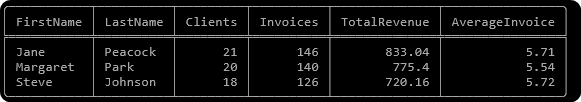

# Вивід `perevir.py`

```cmd
== 1. Треки гурту Queen: трек, альбом
     Name | AlbumTitle
     A Kind Of Magic | Greatest Hits II
     Under Pressure | Greatest Hits II
     Radio GA GA | Greatest Hits II
     … ще 42
  ✅ правильно (рядків: 45)

== 2. Треків у кожному жанрі: жанр, кількість; від найбільшого
     Name | TracksCount
     Rock | 1297
     Latin | 579
     Metal | 374
     … ще 22
  ✅ правильно (рядків: 25)

== 3. Топ-10 клієнтів за сумою покупок: імʼя, прізвище, сума; від найбільшої
     FirstName | LastName | sum
     Helena | Holý | 49.62
     Richard | Cunningham | 47.62
     Luis | Rojas | 46.62
     … ще 7
  ✅ правильно (рядків: 10)

== 4. Виконавці з більш ніж 5 альбомами: виконавець, альбомів; від найбільшого
     Name | Albums
     Iron Maiden | 21
     Led Zeppelin | 14
     Deep Purple | 11
     … ще 3
  ✅ правильно (рядків: 6)

== 5. Виконавці без жодного альбому
     Name
     Milton Nascimento & Bebeto
     Azymuth
     João Gilberto
     … ще 68
  ✅ правильно (рядків: 71)

== 6. Середня тривалість треку по жанрах, хв з одним знаком; від найдовшої
     Name | Minutes
     Sci Fi & Fantasy | 48.5
     Science Fiction | 43.8
     Drama | 42.9
     … ще 22
  ✅ правильно (рядків: 25)

== 7. Виторг за країнами (за рахунками): країна, сума; від найбільшого
     BillingCountry | Sum
     USA | 523.06
     Canada | 303.96
     France | 195.1
     … ще 21
  ✅ правильно (рядків: 24)

== 8. Співробітники підтримки й кількість їхніх клієнтів; від найбільшого
     FirstName | LastName | NumberOfClients
     Jane | Peacock | 21
     Margaret | Park | 20
     Steve | Johnson | 18
  ✅ правильно (рядків: 3)

Разом: 8 з 8 пунктів ✅   (мінімум для зарахування — пункти 1–5)
```

## Моє питання до бази

 `Який співробітник підтримки приніс магазину найбільше грошей зі своїх клієнтів і який у нього середній чек?; від найбільшого`

```sql
SELECT e.FirstName, e.LastName, 
COUNT(DISTINCT c.CustomerId) AS Clients, 
COUNT(i.InvoiceId) AS Invoices,
ROUND(SUM(i.Total), 2) AS TotalRevenue,
ROUND(AVG(i.Total), 2) AS AverageInvoice
FROM Employee e
JOIN Customer c ON e.EmployeeId = c.SupportRepId
JOIN Invoice i ON i.CustomerId = c.CustomerId
GROUP BY e.EmployeeId, e.FirstName, e.LastName
ORDER BY TotalRevenue DESC;
```

## Результат



## Відповідь людською мовою

Найбільше грошей приносить співробітник Джейн Пікок: 833,04 за 146 рахунків. Але це переважно тому, що в неї найбільше клієнтів (21). Середній чек у всіх трьох майже однаковий, близько 5,5~5,7, тож різниця в виторгу зумовлена кількістю клієнтів, а не якістю роботи.
